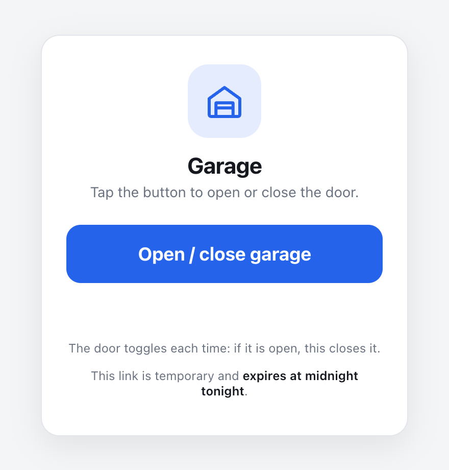
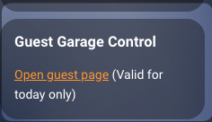

Every so often someone needs to get into our house while we're away, like a family member dropping something off or a repair person showing up early. I didn't want to hand out a garage remote or set up a Home Assistant account for someone who only needs in once. So I built a simple guest page. I copy a link from my Home Assistant dashboard and text it to them. They tap it, get one big button that opens or closes the garage, and the link stops working at midnight.



I worked out the solution with help from [Claude Code](https://claude.com/product/claude-code) (using Opus). It's made up of four small pieces:

1. A **dashboard card** that builds the link for me.
1. A **template sensor** that generates a new key every day.
1. A **static HTML page** served by Home Assistant with the key in the URL.
1. A **webhook automation** that checks the key and toggles the garage door.

There are no custom integrations or add-ons involved, and the guest doesn't have to install anything.

## The dashboard card

I added a Markdown card to my dashboard that shows a link with the current key in it. The key comes from a template sensor, which I'll get to next. When someone needs in, I copy the link and text it to them.

```yaml
type: markdown
content: |
  ### Guest Garage Control
  <a href="https://your-home-assistant-url/local/garage.html#key={{ states('sensor.guest_garage_key') }}" target="_blank" rel="noopener">Open guest page</a> (Valid for today only)
```



## The template sensor

The key looks like `20261020-7c41e9a05d3b82f6c1a9`. The first part is today's date and the second part is the first 20 characters of a SHA-256 hash of the date plus a secret salt. Anyone can see the date, but without the salt there's no way to come up with a hash Home Assistant will accept.

I created the sensor as a template helper in the UI (Settings > Devices & services > Helpers > Create helper > Template > Template a sensor), named it "Guest Garage Key", and gave it this state template:

```jinja2

{% set today = now().strftime('%Y%m%d') %}
{{ today }}-{{ ((today ~ ':' ~ salt) | sha256)[:20] }}
```

_Side note: the key recipe in this post isn't exactly what's running at my house. I changed it up so nobody can use this post to start opening and closing my garage!_

Since the template uses `now()`, Home Assistant re-renders it every minute, and it rolls over to a new key at midnight. That gives me a `sensor.guest_garage_key` entity that the dashboard card uses.

## The static HTML page

Anything in Home Assistant's `www` folder is served at `/local/` without needing to log in, so it was a handy spot for a page a guest opens from a text message. Mine lives at `/homeassistant/www/garage.html`:

```html
<!doctype html>
<html lang="en">
<head>
<meta charset="utf-8">
<meta name="viewport" content="width=device-width, initial-scale=1, viewport-fit=cover">
<meta name="theme-color" content="#f4f5f7">
<title>Garage</title>
<style>
  :root {
    --bg: #f4f5f7;
    --card: #ffffff;
    --fg: #15181e;
    --fg-muted: #6b7280;
    --border: #e3e5ea;
    --accent: #2563eb;
    --accent-fg: #ffffff;
    --ok: #16a34a;
    --err: #dc2626;
    --radius: 18px;
    --sans: -apple-system, BlinkMacSystemFont, "Segoe UI", Roboto, Helvetica, Arial, sans-serif;
  }
  * { box-sizing: border-box; }
  html, body { height: 100%; }
  body {
    margin: 0;
    font-family: var(--sans);
    background: var(--bg);
    color: var(--fg);
    display: flex;
    align-items: center;
    justify-content: center;
    padding: 24px 16px;
    padding-bottom: max(24px, env(safe-area-inset-bottom));
    -webkit-font-smoothing: antialiased;
  }
  .card {
    width: 100%;
    max-width: 360px;
    background: var(--card);
    border: 1px solid var(--border);
    border-radius: var(--radius);
    padding: 28px 24px 24px;
    box-shadow: 0 10px 30px rgba(0,0,0,.08);
    text-align: center;
  }
  .icon {
    width: 72px; height: 72px;
    margin: 0 auto 14px;
    border-radius: 20px;
    background: color-mix(in srgb, var(--accent) 12%, transparent);
    display: grid; place-items: center;
    color: var(--accent);
  }
  .icon svg { width: 40px; height: 40px; }
  h1 { font-size: 22px; font-weight: 700; margin: 0 0 4px; letter-spacing: -.01em; }
  .sub { font-size: 14px; color: var(--fg-muted); margin: 0 0 24px; }
  button {
    width: 100%;
    margin-top: 4px;
    font: inherit;
    font-size: 18px;
    font-weight: 700;
    padding: 18px;
    border: 0;
    border-radius: 14px;
    background: var(--accent);
    color: var(--accent-fg);
    cursor: pointer;
    display: flex; align-items: center; justify-content: center; gap: 10px;
    transition: transform .08s, opacity .15s, background .2s;
    -webkit-tap-highlight-color: transparent;
  }
  button:active { transform: scale(.98); }
  button:disabled { opacity: .6; cursor: default; }
  button.ok { background: var(--ok); }
  button.err { background: var(--err); }
  .spinner {
    width: 18px; height: 18px;
    border: 2.5px solid rgba(255,255,255,.4);
    border-top-color: #fff;
    border-radius: 50%;
    animation: spin .7s linear infinite;
    display: none;
  }
  button.busy .spinner { display: inline-block; }
  @keyframes spin { to { transform: rotate(360deg); } }
  .msg {
    min-height: 20px;
    margin: 16px 0 0;
    font-size: 14px;
    color: var(--fg-muted);
  }
  .msg.ok { color: var(--ok); }
  .msg.err { color: var(--err); }
  .foot {
    margin-top: 20px;
    font-size: 12px;
    color: var(--fg-muted);
  }
  .foot + .foot { margin-top: 6px; }
  .expiry strong { font-weight: 600; color: var(--fg); }
</style>
</head>
<body>
  <main class="card">
    <div class="icon" aria-hidden="true">
      <svg viewBox="0 0 24 24" fill="none" stroke="currentColor" stroke-width="1.8" stroke-linecap="round" stroke-linejoin="round">
        <path d="M3 10.5 12 4l9 6.5V20a1 1 0 0 1-1 1H4a1 1 0 0 1-1-1z"/>
        <path d="M7 21v-8h10v8M7 16h10"/>
      </svg>
    </div>
    <h1>Garage</h1>
    <p class="sub">Tap the button to open or close the door.</p>

    <form id="form" autocomplete="off">
      <button id="go" type="submit">
        <span class="spinner"></span>
        <span class="label">Open / close garage</span>
      </button>
    </form>

    <p id="msg" class="msg" role="status" aria-live="polite"></p>
    <p class="foot">The door toggles each time: if it is open, this closes it.</p>
    <p class="foot expiry">This link is temporary and <strong>expires at midnight tonight</strong>.</p>
  </main>

<script>
  const WEBHOOK = '/api/webhook/guest-garage-YOUR-RANDOM-ID';

  const form = document.getElementById('form');
  const btn = document.getElementById('go');
  const label = btn.querySelector('.label');
  const msg = document.getElementById('msg');

  const key = new URLSearchParams(location.hash.slice(1)).get('key')
           || new URLSearchParams(location.search).get('key') || '';

  function setState(cls, text, note) {
    btn.className = cls;
    label.textContent = text;
    msg.className = 'msg ' + (cls === 'busy' ? '' : cls);
    msg.textContent = note || '';
  }

  function ymd(d) {
    return d.getFullYear() * 10000 + (d.getMonth() + 1) * 100 + d.getDate();
  }

  const issued = parseInt((key.split('-')[0] || ''), 10);
  const today = ymd(new Date());

  if (!/^\d{8}-[0-9a-f]{8,}$/.test(key)) {
    btn.disabled = true;
    setState('err', 'Link not valid', 'This link is incomplete. Ask for a new one.');
  } else if (issued !== today) {
    btn.disabled = true;
    setState('err', 'Link expired', 'This link has expired. Ask for a new one.');
  }

  form.addEventListener('submit', async (e) => {
    e.preventDefault();
    if (btn.disabled) return;

    btn.disabled = true;
    setState('busy', 'Sending…');

    try {
      const r = await fetch(WEBHOOK, {
        method: 'POST',
        headers: { 'Content-Type': 'application/json' },
        body: JSON.stringify({ key })
      });
      if (!r.ok) throw new Error('HTTP ' + r.status);
      setState('ok', 'Sent', 'Request sent. The door should start moving in a few seconds. If it does not, this link may have expired.');
      if (navigator.vibrate) navigator.vibrate(30);
    } catch (err) {
      setState('err', 'Failed', 'Could not reach the house. Check your connection and try again.');
    }

    setTimeout(() => {
      btn.disabled = false;
      setState('', 'Open / close garage', '');
    }, 15000);
  });
</script>
</body>
</html>
```

The key is passed in the URL fragment (`garage.html#key=...`). Browsers don't send the fragment when requesting a page, so the key stays out of server and proxy access logs. It only goes to Home Assistant in the POST body when the button is tapped.

The page also checks the date in the key, but that's just so an old link shows "Link expired" right away instead of a button that does nothing. Home Assistant does the real check.

One quirk: Home Assistant webhooks always return a 200, no matter what the automation decides. The page can't actually tell whether the key was accepted, which is why the success message says "If it does not, this link may have expired."

## The webhook automation

The page POSTs the key to a webhook. The automation computes today's key and only toggles the door if the two match:

```yaml
alias: Guest Garage Control
triggers:
  - webhook_id: guest-garage-YOUR-RANDOM-ID
    allowed_methods:
      - POST
    local_only: false
    trigger: webhook
conditions:
  - condition: template
    value_template: >-
      
      
      {%- set today = now().strftime('%Y%m%d') -%}
      
        {{ parts[1] == ((today ~ ':' ~ salt) | sha256)[:20] }}
      false
actions:
  - target:
      entity_id: cover.garage_door
    action: cover.toggle
    data: {}
  - action: notify.send_message
    target:
      entity_id: notify.my_phone
    data:
      title: Guest Garage Control
      message: The guest garage control button was just used.
mode: single
```

A few notes on this one:

- `local_only: false` is what lets the webhook accept requests from outside my network. Webhooks are local-only by default, and my guests obviously aren't on my Wi-Fi. My Home Assistant instance is already reachable from the internet, so that part was covered.
- Links expire at midnight by Home Assistant's clock. The date check on the page uses the guest's phone clock, so someone in another time zone might see "Link expired" a little early or late, but Home Assistant has the final say.
- Every time the button is used I get a notification on my phone, so I always know when the garage was opened.
- `mode: single` ignores repeat taps while the automation is still running.

## Is this secure?

It's secure enough for my garage, but there are some tradeoffs I'm aware of:

- The salt is the only real secret. Anyone can load the page and view source to see the webhook ID, but without the salt a request to the webhook doesn't do anything.
- The salt needs to be long and random. The hash is cut down to 20 characters, so if the salt were a short word or phrase, someone holding one valid link could guess salts offline until they found one that produced the same hash. Then they could generate keys whenever they wanted.
- Revoking access means changing the salt in both the template sensor and the automation. Any outstanding links stop working right away.
- There's no limit on how many times a link can be used before it expires.
- It's a toggle, so a guest can close the garage just as easily as open it.

That's it! Now when someone needs into the garage, I text them a link and don't have to think about it again.
