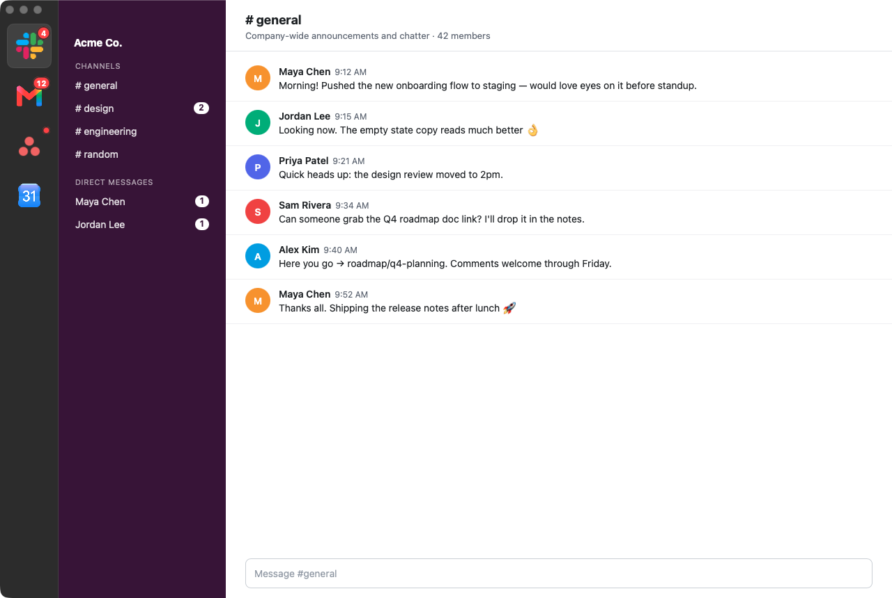
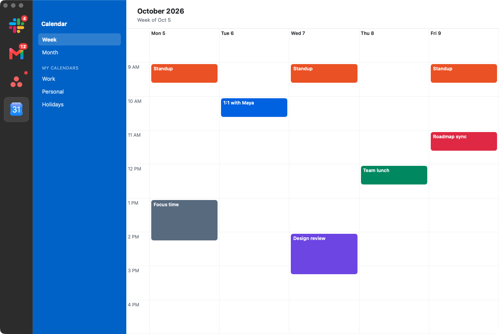

For a long time I used [Ferdium](https://ferdium.org) as one of my main work apps to keep "things that need my attention" in one place.  It was very helpful to have an app that would show badge notifications when I had something new to read, something new to respond to, or something that needed my attention.  I had Gmail, Slack, Calendar, Asana, GitHub and a few more set up there.  Keeping this in a dedicated app separate from my browser tabs helped me focus. I still wanted a way to keep chat, email, and calendar web apps together in one window, separate from my browser tabs. Ferdium did the job but always felt heavier than what I really needed.  I didn't need or want the app to be tied to a server and I only used a very small number of its features.  Also, occasionally the Ferdium server would go down and I couldn't use it which was frustrating.  All I really wanted was an app with a sidebar of web apps, unread badges, and notifications. So I built my own: [Switchboard](https://github.com/bradymholt/switchboard) with the help of Claude Code (Opus) and a little bit of time in the afternoon.

Here's what it looks like:



Switchboard is a small Swift app built on the system WebKit, which means it's always as current as Safari and doesn't bundle a browser engine. Yes, I built it fully with Opus and it's pretty awesome that you can build tools for yourself like this with very minimal effort these days.

## Overview

### Unread badges

Each service in the sidebar gets a badge, and the Dock icon shows the total. Most web apps already put an unread count in the page title, like `(4) Slack`, so Switchboard reads that by default. It also supports the [Badging API](https://developer.mozilla.org/en-US/docs/Web/API/Badging_API) and shows a dot after a service sends a notification.

When a site doesn't expose a count, the `badge` field takes a JavaScript expression that runs in the page every three seconds. A number shows a count badge and `true` shows a dot.

### Native notifications

`WKWebView` doesn't implement the web Notification API, so Switchboard injects a small script into every page that stands in for `Notification` and passes notifications to the app. They show up as regular macOS notifications, and clicking one brings up the right service and fires the page's own `onclick` handler, just like it would in a browser.



### One JSON file

There's no settings screen. Services are defined in a single JSON file at `~/.config/switchboard/services.json`, and pressing ⌘, opens it in your default editor.

```json
[
  { "name": "Slack", "url": "https://app.slack.com/client", "userAgent": "chrome" },
  { "name": "Gmail", "url": "https://mail.google.com/mail/u/0/", "profile": "work" },
  { "name": "Asana", "url": "https://app.asana.com", "badge": "document.querySelectorAll('.unread').length" },
  { "name": "Calendar", "url": "https://calendar.google.com" }
]
```

Only `name` and `url` are required. Switchboard checks the file every couple of seconds, so changes show up without restarting the app. Icons are fetched from each site automatically (web app manifest, then apple-touch-icon, then favicon), or you can point `icon` at your own image.

### Multiple accounts

The `profile` field gives a service its own cookie and login storage. Services that share a profile share logins, and services with different profiles are fully isolated. That makes it easy to run two accounts on the same site side by side, like a personal Gmail and a work Gmail.

### Links go where you expect

A lot of the work in a wrapper like this is deciding what happens when you click a link:

- A link to another configured service switches to that service instead of opening a new window.
- Links to other sites open in your default browser.
- Sign-in popups for Google, Microsoft, Apple, Okta, and others stay in the app so logging in works.

Some sites need a nudge. Slack huddles, for example, work when Slack thinks it's talking to Chrome, so setting `"userAgent": "chrome"` lets a service present itself as the installed version of Chrome.

### Small stuff

Switchboard has the keyboard shortcuts you'd expect: ⌘1–9 to switch services, ⌘R to reload, ⌘[ and ⌘] for back and forward, ⌘F to find in the page, and zoom with ⌘= / ⌘-. Closing the window just hides it, so services keep running in the background and notifications keep coming. The Web Inspector is under View if you need to dig into a page.

## Try it

Switchboard requires macOS 15 or later.  Follow the [Install instructions here](https://github.com/bradymholt/switchboard#install) to try it out.  The source is on [GitHub](https://github.com/bradymholt/switchboard) under the MIT license.
